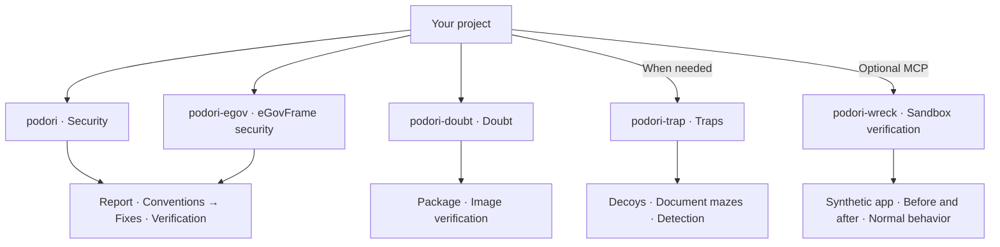

# podori · Security code review skills for AI coding agents

**Security fixes with checks for normal behavior.**

[한국어 안내](README.md) | English · `0.6.0`

podori is a collection of security skills for AI coding agents. It guides application and web security code reviews, vulnerability fixes, and regression tests.

Independent skills cover eGovFrame secure coding, package and container image supply-chain security, and decoys and traps on request. Sandbox verification compares only the bundled synthetic app.

## Background

My team recently patched vulnerabilities in Node.js, Python, Java, and nginx across dozens of repositories. I share the checklists and procedures for fixes and verification from that work so other developers can use them.

## Choose your skill

Start with `podori` for application and web security code reviews. Use `podori-egov` for eGovFrame projects.

| When you want to… | Use this skill |
|---|---|
| Find and fix application or web vulnerabilities, then run regression tests | [podori · Security](skills/podori/SKILL.md) |
| Review government security criteria and secure coding for the relevant eGovFrame version | [podori-egov · eGovFrame security](skills/podori-egov/SKILL.md) |
| Check package and container image provenance and supply-chain security | [podori-doubt · Doubt](skills/podori-doubt/SKILL.md) |
| Detect unauthorized exploration with decoys and traps | [podori-trap · Traps](skills/podori-trap/SKILL.md) |
| Compare vulnerable and fixed variants of the bundled synthetic app | [podori-wreck · Sandbox verification](skills/podori-wreck/SKILL.md) |

Each skill works independently and does not invoke the others.

<details>
<summary>See each skill's role at a glance</summary>

This diagram shows responsibilities, not an execution sequence.



</details>

## Start here

1. Copy the complete selected `skills/<skill-name>/` directory into the agent's skill location. For a general security review, select `skills/podori/`.
2. Invoke the skill in the target project. This example uses an agent that supports slash commands.

```text
/podori
```

The agent reads project code and configuration to select the review target. You do not need an additional task prompt. If project evidence or required approval is missing, the agent asks a focused question. A review-only request leaves the code unchanged.

Installation paths and invocation syntax depend on the agent. Each skill folder includes the instructions and references for its review procedure.

For an update, select release tag `v0.6.0`. Back up the current installation before you replace the complete selected folder. Verify the `SKILL.md` version and all package files against that tag. Unused skills need no installation.

## Explore the skills

### podori · Security

A hidden admin button does not lock the API behind it.

`podori` examines code and configuration from an attacker's perspective. It checks authorization, input validation, file uploads, and attacks that combine multiple weaknesses. It records security findings and existing code conventions, then fixes confirmed defects within approved scope. It then verifies security, normal behavior, and convention compliance.

```text
/podori
```

Review-only requests leave the code unchanged. The skill does not add traps automatically.

### podori-egov · eGovFrame security

`podori-egov` guides eGovFrame secure coding reviews, fixes for confirmed defects, and regression checks. It distinguishes runtime, common-component, and actual dependency versions before the applicable 3.x, 4.x, and 5.x rules and cases.

The package includes 20 design criteria and 49 implementation criteria from MOIS Notice 2025-1, Appendix 3. Each criterion has applicability conditions, local checks, and verification targets. The [criterion coverage record](skills/podori-egov/templates/criteria-coverage.md) captures evidence and results. The [sources and baseline edition](skills/podori-egov/references/government-baseline.md) identify the original documents and their scope.

Connected and isolated hosts use the same baseline and procedure without external queries. The [eGovFrame security and offline guide](skills/podori-egov/README.en.md) explains prerequisites and unresolved evidence.

```text
/podori-egov
```

See the [3.x CSRF configuration](skills/podori-egov/references/versions/3.x/cases/csrf/README.en.md), [4.x CSRF configuration](skills/podori-egov/references/versions/4.x/cases/csrf/README.en.md), and [5.x ownership](skills/podori-egov/references/versions/5.x/cases/ownership/README.en.md) cases for commands and expected results.

It does not infer safety or support beyond verified versions. Case tests do not replace target-project verification.

### podori-doubt · Doubt

A familiar package does not make its install script trustworthy.

The skill performs read-only supply-chain security checks on packages and container images. It examines install scripts, startup commands, and image layers against approved baselines. It also verifies signatures and build records. Within approved scope, it traces usage through registry and cluster queries.

```text
/podori-doubt
```

The skill does not install suspect packages, execute suspect images, or modify the inspected artifacts. It separates verified facts, suspicions, and unverified checks in its report.

### podori-trap · Traps

Decoy keys, fake APIs, and document mazes divert unauthorized exploration and leave an access record. The server verifies the access event.

```text
/podori-trap
```

Traps stay within operator-controlled services. Decoys have no connection to real data or privileges. Hidden decoy events are also an option, but ordinary page views and DOM inspection do not count as attacks.

New traps start disabled. Production activation requires resource limits, exit conditions, and separate approval.

### podori-wreck · Sandbox verification

Compare vulnerable and fixed variants of the bundled synthetic HTTP app. The MCP sends identical requests from identical initial data and verifies authorization and input-validation results. It also verifies that normal requests still work.

```text
/podori-wreck
```

The current target is only the bundled synthetic app. The local stdio MCP verifies host-issued approval for the report item before execution. The model cannot issue approval.

If the MCP cannot verify external network denial, isolation, or resource and time limits, it stops execution. Evidence contains actual requests, responses, and state observations. Cleanup removes only the experiment resources. Unexecuted items remain unverified.

The MCP refuses arbitrary repositories, images, paths, shell commands, and production or external targets. It also excludes autonomous exploration, vulnerability chains, code-execution demonstrations, destructive tests, and resource-exhaustion tests. This is not a general sandbox for malicious code. Read the [MCP guide](mcp/README.en.md) for detailed execution requirements.

## Results and completion

Each skill first freezes the task scope, completion criteria, and required checks. Security fixes address confirmed defects and preserve normal behavior. The task ends when all required checks pass, without another search for improvements.

The default work budget is 30 minutes and two attempts per required item, inclusive of the first attempt. Users can specify different finite limits. Stricter host and approval limits take precedence. Report updates and subagent delegation do not reset the budget.

Valid evidence remains reusable while its relevant inputs remain unchanged. Only changed inputs and affected boundaries require another check. The agent stops when a repeated failure has no new evidence or a patch restores an earlier failure state. At the limit, it stops new investigation, edits, and tests. Only the report and authorized cleanup continue. Unfinished required work returns `BLOCKED`.

Separate defects and optional improvements stay on a follow-up list. `podori-doubt` traces source-linked dependency, build, install, and runtime paths through read-only checks. A shared registry does not justify more targets.

These budgets are agent instructions. Hard time and token limits require host controls. Without a token meter, usage remains unmeasured, with no estimate of token savings.

## Frequently asked questions

### Can I copy only `SKILL.md`?

Copy the complete selected skill folder. `SKILL.md` defines the procedure. The `references/` and `templates/` directories contain detailed rules and report templates. The review uses the bundled instructions without access to source links. Agent instructions use English, and user-facing READMEs have paired Korean and English versions.

### Does podori require MCP?

`podori`, `podori-egov`, `podori-doubt`, and `podori-trap` work without MCP. Only `podori-wreck` requires a separate local MCP server and host-issued execution approval. Read the [MCP guide](mcp/README.en.md) for setup.

### Can I use podori in an air-gapped environment?

`podori-egov` uses the same bundled criteria and local evidence on connected and isolated hosts. An isolated host needs an internal agent, model, and the required local tools and dependencies. The skill does not fetch external data or install tools during review. Source and CVE updates remain separate tasks. Read the [offline guide](skills/podori-egov/README.en.md) for prerequisites.

### Does the government baseline replace security certification?

`podori-egov` supports development-security reviews against its bundled source edition. It does not replace official certification or establish legal compliance. Version-specific cases and the `podori-wreck` synthetic app tests do not establish the security of an actual project.

## What to expect

Skills provide instructions for an agent. Installation alone does not activate defenses in the target project. The `podori-wreck` MCP does not establish the safety of a production environment.

Unverified checks do not become safety claims. Registry and cluster queries stay within approved scope. Production changes require separate approval.

[Changelog](CHANGELOG.md) · [MIT](LICENSE) · VerifiedIdiot
