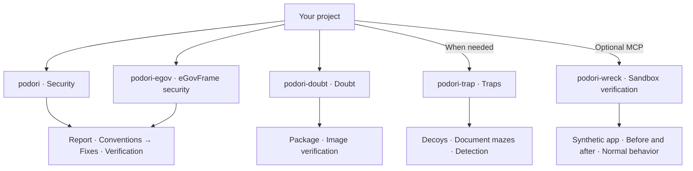

# podori

[한국어 안내](README.md) | English

The current version is `0.5.0`.

**Application and web security skills for AI coding agents.**

One missing authorization check can expose another user's data, even when the feature works correctly. A familiar container image can contain an unfamiliar startup script.

podori gives your agent independent skills to examine these gaps. The skills help your agent fix vulnerabilities, question apparently safe dependencies, and prepare decoys to detect unauthorized exploration.

## Start here

Copy the complete selected `skills/<skill-name>/` directory into the agent's skill location. Each package contains the required instructions and references. Source links are not required inputs.

Invoke the security, eGovFrame, doubt, or trap skill in the target project without an additional task prompt. The agent selects targets from project evidence. `podori-wreck` requires the separate MCP package and report-bound execution approval. It currently supports only the bundled synthetic application.

If project evidence cannot resolve the target or a required approval, the agent asks a focused question. Installation paths and invocation syntax depend on the agent. The examples below show skill-only calls for agents that support slash commands.

## Skill overview

Code security comes first. Select `podori-egov` for eGovFrame projects. Each skill works independently and does not invoke the others. The other four skills do not require the MCP package.

| Theme | Skill | Purpose |
|---|---|---|
| Security | [podori](skills/podori/SKILL.md) | Use a security report to guide fixes and tests. |
| eGovFrame security | [podori-egov](skills/podori-egov/SKILL.md) | Apply the same procedure with version-specific eGovFrame rules and code cases. |
| Doubt | [podori-doubt](skills/podori-doubt/SKILL.md) | Verify the origins and contents of packages and images, even those that appear safe. |
| Traps | [podori-trap](skills/podori-trap/SKILL.md) | Set decoys and traps to detect unauthorized exploration. |
| Sandbox verification | [podori-wreck](skills/podori-wreck/SKILL.md) | Compare report-linked behavior and normal operations in the approved synthetic application. |

## Finish the report, then return

Code can always receive further improvements. A single task does not need an unlimited review loop. Version 0.5.0 freezes confirmed report items and completion criteria before fixes.

Post-change review verifies those items and checks for regressions from the current changes. If every required item and check passes, the task returns immediately. A second successful review is not mandatory.

Separate defects and optional improvements enter a follow-up list, not the current worklist. If required authority or evidence cannot be obtained, the task returns its unresolved items and blockers. A retry limit cannot produce a forced success.

For `podori-doubt`, completion means that the read-only assessment ends. It does not authorize artifact execution or repair.

### podori · Security

A hidden admin button does not protect an API that anyone can call.

`podori` examines code from an attacker's perspective. It checks authorization, input validation, file uploads, and attacks that combine multiple weaknesses. It records security findings and existing code conventions before changes. It fixes confirmed defects within approved scope. It then verifies security, normal behavior, and convention compliance.

```text
/podori
```

Review-only requests leave the code unchanged. The skill does not add traps automatically.

### podori-egov · eGovFrame security

`podori-egov` preserves the report, convention, fix, and verification procedure. It includes common security rules and separate 3.x, 4.x, and 5.x rules with code cases.

```text
/podori-egov
```

It checks runtime, common-component, and actual dependency versions separately. It does not infer safety or support beyond verified versions. Case tests do not replace target-project verification.

### podori-doubt · Doubt

A familiar source does not prove harmless content. A clean vulnerability scan does not clear suspicious code in a startup script.

`podori-doubt` examines package install scripts, image startup commands, and layers. It compares approved baselines, signatures, and build records. Within approved scope, it traces usage through read-only registry and cluster queries.

```text
/podori-doubt
```

The skill does not install suspect packages or execute suspect images for inspection. It separates verified facts, suspicions, and unverified checks.

### podori-trap · Traps

The API behind the fake key and the documents beyond it contain no real secrets.

`podori-trap` helps your agent create decoy keys, APIs, and document mazes for the project. Decoys divert unauthorized exploration and record server-verified decoy access. Traps stay within operator-controlled services.

```text
/podori-trap
```

Decoys have no connection to real data or privileges. Hidden decoy events are also an option. Ordinary page views and DOM inspection do not count as attacks.

New traps start disabled. Production activation requires resource limits, exit conditions, and separate approval.

### podori-wreck · Sandbox verification

Verify report claims against actual behavior. An optional local stdio MCP runs bounded authorization and input-validation cases in a bundled HTTP application. It sends identical requests to vulnerable and fixed variants from identical initial data. It also verifies normal requests.

```text
/podori-wreck
```

The current target is only the bundled synthetic application. Arbitrary repositories, images, paths, and shell commands are not accepted. A trusted host process supplies execution approval, not the model. Read the [MCP guide](mcp/README.md) for setup and approval steps.

Execution requires external network denial, host and cross-experiment isolation, and resource and time limits. If required controls cannot be verified, execution stops. Production or external targets, autonomous exploration, vulnerability chains, code-execution demonstrations, destructive tests, and resource-exhaustion tests are excluded.

Evidence contains actual requests, responses, and state observations. Unexecuted items remain unverified. Cleanup removes only the experiment resources. This feature is not a general sandbox for arbitrary malicious code.

## Choose the skill for the task

This diagram shows responsibilities, not an execution sequence.



## Version 0.5.0 features and verification scope

Version 0.5.0 includes bounded sandbox verification and report-based completion rules.

- [Sandbox setup and approval steps](mcp/README.md)
- [Report completion rules](skills/podori/references/report-completion.md)

Instruction checks, synthetic reader scenarios, and actual MCP or container tests provide different evidence. Instruction access alone does not establish automatic runtime enforcement.

## What to expect

Skills provide instructions for an agent. Installation alone does not activate defenses in the target project. The optional `podori-wreck` MCP is a separate development tool, not verification of a production environment.

Reports include evidence and actual test results. Unverified checks do not become safety claims. Registry and cluster queries stay within approved scope. Production changes require separate approval.

Skill instructions and references use English. The instruction package version is `0.5.0`. That version does not establish application deployment or measured security effectiveness.

[Changelog](CHANGELOG.md) · [MIT](LICENSE) · VerifiedIdiot
