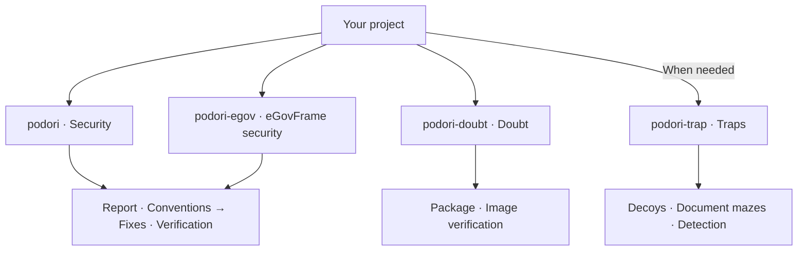

# podori

[한국어 안내](README.md) | English

**Application and web security skills for AI coding agents.**

One missing authorization check can expose another user's data, even when the feature works correctly. A familiar container image can contain an unfamiliar startup script.

podori gives your agent independent skills to examine these gaps. The skills help your agent fix vulnerabilities, question apparently safe dependencies, and prepare decoys to detect unauthorized exploration.

## Start here

Copy the complete selected `skills/<skill-name>/` directory into the agent's skill location. Each package contains the required instructions and references. Source links are not required inputs.

Invoke the selected skill in the target project. You do not need an additional task prompt. The agent reads project code and configuration to select inspection targets or suitable traps.

If project evidence cannot resolve the target or a required approval, the agent asks a focused question. Installation paths and invocation syntax depend on the agent. The examples below show skill-only calls for agents that support slash commands.

## Skill overview

Code security comes first. Select `podori-egov` for eGovFrame projects. Each skill works independently and does not invoke the others.

| Theme | Skill | Purpose |
|---|---|---|
| Security | [podori](skills/podori/SKILL.md) | Use a security report to guide fixes and tests. |
| eGovFrame security | [podori-egov](skills/podori-egov/SKILL.md) | Apply the same procedure with version-specific eGovFrame rules and code cases. |
| Doubt | [podori-doubt](skills/podori-doubt/SKILL.md) | Verify the origins and contents of packages and images, even those that appear safe. |
| Traps | [podori-trap](skills/podori-trap/SKILL.md) | Set decoys and traps to detect unauthorized exploration. |

### podori · Security

A hidden admin button does not protect an API that anyone can call.

`podori` examines code from an attacker's perspective. It checks authorization, input validation, file uploads, and attacks that combine multiple weaknesses. It records security findings and existing code conventions before changes. It fixes confirmed defects within approved scope. It then verifies security, normal behavior, and convention compliance.

```text
/podori
```

Review-only requests leave the code unchanged. The skill does not add traps automatically.

### podori-egov · eGovFrame security

`podori-egov` preserves the report, convention, fix, and verification procedure. It includes common security rules and separate 3.x, 4.x, and 5.x rules with code cases.

```text
/podori-egov
```

It checks runtime, common-component, and actual dependency versions separately. It does not infer safety or support beyond verified versions. Case tests do not replace target-project verification.

### podori-doubt · Doubt

A familiar source does not prove harmless content. A clean vulnerability scan does not clear suspicious code in a startup script.

`podori-doubt` examines package install scripts, image startup commands, and layers. It compares approved baselines, signatures, and build records. Within approved scope, it traces usage through read-only registry and cluster queries.

```text
/podori-doubt
```

The skill does not install suspect packages or execute suspect images for inspection. It separates verified facts, suspicions, and unverified checks.

### podori-trap · Traps

The API behind the fake key and the documents beyond it contain no real secrets.

`podori-trap` helps your agent create decoy keys, APIs, and document mazes for the project. Decoys divert unauthorized exploration and record server-verified decoy access. Traps stay within operator-controlled services.

```text
/podori-trap
```

Decoys have no connection to real data or privileges. Hidden decoy events are also an option. Ordinary page views and DOM inspection do not count as attacks.

New traps start disabled. Production activation requires resource limits, exit conditions, and separate approval.

## Choose the skill for the task

This diagram shows responsibilities, not an execution sequence.



## 0.4.0 plan: sandbox reproduction and regression verification

The next version will reproduce report claims in approved sandboxes and check whether the fixed version prevents the same behavior. The feature name is `podori-wreck`.

- Reproduce report items through bounded scenarios with approved target copies and synthetic data.
- Record actual requests, responses, and state changes.
- Compare the original and fixed versions under identical initial conditions.
- Verify normal behavior alongside each reported defect.
- If execution is unavailable, retain an unverified result instead of a safety claim.

The design requires external network denial, isolation from the host and other experiments, and resource and time limits. If these controls are unavailable, execution must stop.

Version 0.4.0 excludes production or external targets, autonomous exploration, vulnerability chains, arbitrary commands, code-execution demonstrations, destructive tests, and resource-exhaustion tests.

**Version 0.4.0 is an unimplemented plan. The current package contains four skills at version 0.3.0, without the sandbox MCP server or `podori-wreck`.**

The [0.4.0 design document](docs/0.4.0-sandbox-validation.md) defines the scope and acceptance criteria.

## What to expect

podori provides instructions for an agent, not an active security service. Installation alone does not activate defenses. An agent must implement and test actual controls in the target project.

Reports include evidence and actual test results. Unverified checks do not become safety claims. Registry and cluster queries stay within approved scope. Production changes require separate approval.

All four skills include English instructions, references, and templates. Their version is `0.3.0`.

[Changelog](CHANGELOG.md) · [MIT](LICENSE) · VerifiedIdiot
