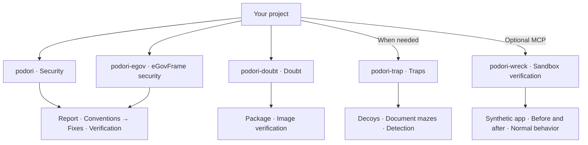

# podori

**Application and web security skills for AI coding agents.**

[한국어 안내](README.md) | English · `0.5.0`

podori helps your agent find and fix vulnerabilities, and question packages and images that appear safe. On request, it creates decoys and traps that record unauthorized exploration.

## Choose your skill

Start with `podori` for application and web code. Use `podori-egov` for eGovFrame projects.

| When you want to… | Use this skill |
|---|---|
| Find and fix security defects in application or web code | [podori · Security](skills/podori/SKILL.md) |
| Check security against the relevant eGovFrame version | [podori-egov · eGovFrame security](skills/podori-egov/SKILL.md) |
| Examine the origins and contents of a package or image | [podori-doubt · Doubt](skills/podori-doubt/SKILL.md) |
| Detect unauthorized exploration with decoys and traps | [podori-trap · Traps](skills/podori-trap/SKILL.md) |
| Compare vulnerable and fixed variants of the bundled synthetic app | [podori-wreck · Sandbox verification](skills/podori-wreck/SKILL.md) |

Each skill works independently and does not invoke the others.

<details>
<summary>See each skill's role at a glance</summary>

This diagram shows responsibilities, not an execution sequence.



</details>

## Start here

1. Copy the complete selected `skills/<skill-name>/` directory into the agent's skill location. For a general security review, select `skills/podori/`.
2. Invoke the skill in the target project. This example uses an agent that supports slash commands.

```text
/podori
```

The agent reads project code and configuration to select the review target. You do not need an additional task prompt. If project evidence or required approval is missing, the agent asks a focused question. A review-only request leaves the code unchanged.

Installation paths and invocation syntax depend on the agent. Each folder includes instructions and references, so source links are not required inputs.

The security, eGovFrame, doubt, and trap skills do not require MCP. Only `podori-wreck` requires a separate local MCP server and host-issued execution approval. Read the [MCP guide](mcp/README.md) for setup.

## Explore the skills

### podori · Security

A hidden admin button does not lock the API behind it.

`podori` examines code and configuration from an attacker's perspective. It checks authorization, input validation, file uploads, and attacks that combine multiple weaknesses. It records security findings and existing code conventions, then fixes confirmed defects within approved scope. It then verifies security, normal behavior, and convention compliance.

```text
/podori
```

Review-only requests leave the code unchanged. The skill does not add traps automatically.

### podori-egov · eGovFrame security

Start with the eGovFrame version. The skill distinguishes runtime, common-component, and actual dependency versions. It applies security rules and code cases for 3.x, 4.x, and 5.x.

It follows the same report, fix, and verification procedure as `podori`.

```text
/podori-egov
```

It does not infer safety or support beyond verified versions. Case tests do not replace target-project verification.

### podori-doubt · Doubt

A familiar package does not make its install script trustworthy.

The skill examines package install scripts, image startup commands, and layers. It compares approved baselines and verifies signatures and build records. Within approved scope, it traces usage through read-only registry and cluster queries.

```text
/podori-doubt
```

The skill does not install suspect packages, execute suspect images, or modify the inspected artifacts. It separates verified facts, suspicions, and unverified checks in its report.

### podori-trap · Traps

Decoy keys, fake APIs, and document mazes divert unauthorized exploration and leave an access record. The server verifies the access event.

```text
/podori-trap
```

Traps stay within operator-controlled services. Decoys have no connection to real data or privileges. Hidden decoy events are also an option, but ordinary page views and DOM inspection do not count as attacks.

New traps start disabled. Production activation requires resource limits, exit conditions, and separate approval.

### podori-wreck · Sandbox verification

Compare vulnerable and fixed variants of the bundled synthetic HTTP app. The MCP sends identical requests from identical initial data and verifies authorization and input-validation results. It also verifies that normal requests still work.

```text
/podori-wreck
```

The current target is only the bundled synthetic app. The local stdio MCP verifies host-issued approval for the report item before execution. The model cannot issue approval.

If the MCP cannot verify external network denial, isolation, or resource and time limits, it stops execution. Evidence contains actual requests, responses, and state observations. Cleanup removes only the experiment resources. Unexecuted items remain unverified.

The MCP refuses arbitrary repositories, images, paths, shell commands, and production or external targets. It also excludes autonomous exploration, vulnerability chains, code-execution demonstrations, destructive tests, and resource-exhaustion tests. This is not a general sandbox for malicious code. Read the [MCP guide](mcp/README.md) for detailed execution requirements.

## Results and completion

Each skill first defines the task scope, completion criteria, and required checks in its report. When every required item and check passes, it returns the result. Security fixes also require related regression checks.

Separate defects and optional improvements stay on a follow-up list. If required approval or evidence is unavailable, the agent reports unresolved items and stops. `podori-doubt` returns a read-only assessment without changes.

## What to expect

Skills provide instructions for an agent. Installation alone does not activate defenses in the target project. The `podori-wreck` MCP does not establish the safety of a production environment.

Unverified checks do not become safety claims. Registry and cluster queries stay within approved scope. Production changes require separate approval. Skill instructions and references use English.

[Changelog](CHANGELOG.md) · [MIT](LICENSE) · VerifiedIdiot
