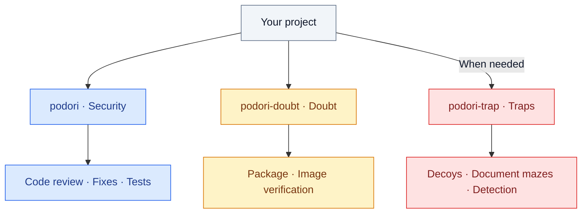

<div align="center">

# podori


**Application and web security skills for AI coding agents.**

`v0.1.0` · **MIT** · Three independent skills

English | [한국어](README.md)

[Start here](#start) · [Security](#secure-code) · [Doubt](#doubt) · [Traps](#trap)

</div>

One missing authorization check can expose another user's data, even when the feature works correctly. A familiar container image can contain an unfamiliar startup script.

podori gives your agent three skills to examine these gaps. The skills help your agent fix vulnerabilities, question apparently safe dependencies, and prepare decoys for hostile exploration.

| Theme | Skill | Purpose |
|---|---|---|
| Security | [podori](skills/podori/SKILL.md) | Find and fix vulnerabilities, then verify the fixes with tests. |
| Doubt | [podori-doubt](skills/podori-doubt/SKILL.md) | Verify the origins and contents of packages and images, even those that appear safe. |
| Traps | [podori-trap](skills/podori-trap/SKILL.md) | Set decoys and traps to detect hostile exploration. |

Code security comes first. Select dependency checks and traps when needed. Each skill works independently and does not invoke the others.

---

<a id="start"></a>

## Start here

Copy the complete selected `skills/<skill-name>/` directory into the agent's skill location. Each directory contains instructions, references, and templates.

> [!TIP]
> Invoke the selected skill in the target project. You do not need an additional task prompt. The agent reads project code and configuration to select inspection targets or suitable traps.

If project evidence cannot resolve the target or a required approval, the agent asks a focused question. Installation paths and invocation syntax depend on the agent. The examples below show skill-only calls for agents that support slash commands.

<a id="secure-code"></a>

### podori · Security

A hidden admin button does not protect an API that anyone can call.

`podori` examines code from an attacker's perspective. It checks authorization, input validation, file uploads, and attacks that combine multiple weaknesses. It fixes verified defects and tests existing behavior for regressions.

```text
/podori
```

Review-only requests leave the code unchanged. The skill does not add traps automatically.

<a id="doubt"></a>

### podori-doubt · Doubt

A familiar source does not prove harmless content. A clean vulnerability scan does not clear suspicious code in a startup script.

`podori-doubt` examines package install scripts, image startup commands, and layers. It compares approved baselines, signatures, and build records. Within approved scope, it traces usage through read-only registry and cluster queries.

```text
/podori-doubt
```

The skill does not install suspect packages or execute suspect images for inspection. It separates verified facts, suspicions, and unverified checks.

<a id="trap"></a>

### podori-trap · Traps

The API behind the fake key and the documents beyond it contain no real secrets.

`podori-trap` helps your agent create decoy keys, APIs, and document mazes for the project. Decoys divert hostile exploration and record server-verified decoy access. Traps stay within operator-controlled services.

```text
/podori-trap
```

Hidden decoy events are also an option. Ordinary page views and DOM inspection do not count as attacks. Decoys have no connection to real data or privileges.

New traps start disabled. Production activation requires resource limits, exit conditions, and separate approval.

## Choose the skill for the task

This diagram shows responsibilities, not an execution sequence.



## What to expect

podori provides instructions for an agent, not an active security service. Installation alone does not activate defenses. An agent must implement and test actual controls in the target project.

Reports include evidence and actual test results. Unverified checks do not become safety claims. Registry and cluster queries stay within approved scope. Production changes require separate approval.

All three skills include English instructions, references, and templates.

[Changelog](CHANGELOG.md) · [MIT](LICENSE) · VerifiedIdiot
