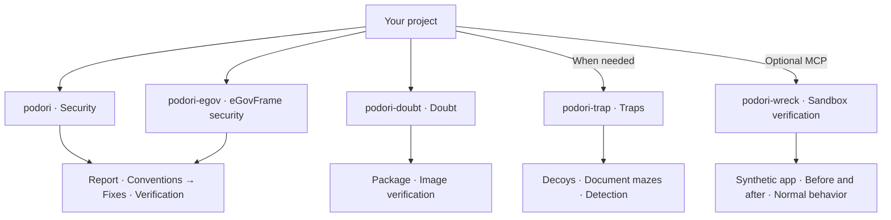

# podori · Security code review skills for AI coding agents

**Fix vulnerabilities. Verify that normal behavior still works.**

[한국어 안내](README.md) | English · `1.0.0`

podori is a collection of security skills for AI coding agents. It reviews code and configuration for vulnerabilities, then guides approved fixes and regression checks for normal behavior. Select the skill that fits the task and use it on its own.

Independent skills cover eGovFrame secure coding, package and container image supply-chain security, and decoys and traps on request. Sandbox verification isolates the app to help protect the host OS, then compares behavior before and after changes.

## Start here

1. Copy the complete selected `skills/<skill-name>/` directory into the agent's skill location. For a general security review, select `skills/podori/`.
2. Invoke the skill in the target project. This example uses an agent that supports slash commands.

```text
/podori
```

The agent reads project code and configuration to select the review target. You do not need an additional task prompt. If project evidence or required approval is missing, the agent asks a focused question. A review-only request leaves the code unchanged.

Installation paths and invocation syntax depend on the agent. Each skill folder includes the instructions and references for its review procedure.

For an update, select release tag `v1.0.0`. Back up the current installation before you replace the complete selected folder. Verify the `SKILL.md` version and all package files against that tag. Unused skills need no installation.

## Choose your skill

Start with `podori` for application and web security code reviews. Use `podori-egov` for eGovFrame projects.

| When you want to… | Use this skill |
|---|---|
| Find and fix application or web vulnerabilities, then run regression tests | [podori · Security](skills/podori/SKILL.md) |
| Review government security criteria and secure coding for the relevant eGovFrame version | [podori-egov · eGovFrame security](skills/podori-egov/SKILL.md) |
| Check package and container image provenance and supply-chain security | [podori-doubt · Doubt](skills/podori-doubt/SKILL.md) |
| Detect unauthorized exploration with decoys and traps | [podori-trap · Traps](skills/podori-trap/SKILL.md) |
| Compare app behavior before and after changes in isolation to help protect the host OS | [podori-wreck · Sandbox verification](skills/podori-wreck/SKILL.md) |

Each skill works independently and does not invoke the others.

<details>
<summary>See each skill's role at a glance</summary>

This diagram shows responsibilities, not an execution sequence.



</details>

## Background

My team recently patched vulnerabilities in Node.js, Python, Java, and nginx across dozens of repositories. I share the checklists and procedures for fixes and verification from that work so other developers can use them.

## How a task runs

Each skill first freezes the task scope, completion criteria, and required checks. The instructions select references by implementation, assessment, or repair phase. Ordinary feature work does not start a full security audit.

A review-only task reports source evidence and unverified items. Unexecuted behavior remains unverified, and the code stays unchanged. A repair task, or a task that requires executable verification, uses the target project's actual tests to confirm both security conditions and normal behavior. Required tests, assertions, and commands are frozen before changes, and actual test results decide the outcome. Missing, skipped, or unexecuted required tests do not pass.

The security, eGovFrame, and dependency skills record vulnerability severity with CVSS v4.0. Unsupported scores remain unrated and are not downgraded to a low severity. Severity does not replace approvals or required verification.

When current vulnerability evidence is required, approved network access and prepared tools support official API and vendor advisory queries. The task freezes evidence for the exact target versions before review. Edits do not restart the search. Isolated hosts use imported evidence. Stale records and failed queries do not establish safety.

Confirmed defects form one correction batch with checks for both security and normal behavior. The task ends when all required checks pass, without another search for improvements. It permits at most two repair/review rounds. The default work budget is 30 minutes and two attempts per required item, inclusive of the first attempt. Users can specify different finite limits. Stricter host and approval limits take precedence. Report updates and subagent delegation do not reset the budget.

Valid evidence remains reusable while its relevant inputs remain unchanged. Only changed inputs and affected boundaries require another check. The agent stops when a repeated failure has no new evidence or a patch restores an earlier failure state. At the limit, it stops new investigation, edits, and tests. Only the report and authorized cleanup continue. Unfinished required work returns `BLOCKED`.

Separate defects and optional improvements stay on a follow-up list. `podori-doubt` traces source-linked dependency, build, install, and runtime paths through read-only checks. A shared registry does not justify more targets.

Conditional references and work budgets are agent instructions. They do not install context isolation or host-enforced limits, and no particular agent or additional MCP server is mandatory. Hard time and token limits require host controls. Without a token meter, usage remains unmeasured, with no estimate of token savings.

## Explore the skills

### podori · Security

A hidden admin button does not lock the API behind it.

`podori` examines code and configuration from an attacker's perspective. It checks authorization, input validation, file uploads, and attacks that combine multiple weaknesses. It records security findings and existing code conventions, then fixes confirmed defects within approved scope. It then verifies security, normal behavior, and convention compliance.

```text
/podori
```

Review-only requests leave the code unchanged. The skill does not add traps automatically.

### podori-egov · eGovFrame security

`podori-egov` guides eGovFrame secure coding reviews, fixes for confirmed defects, and regression checks. It distinguishes runtime, common-component, and actual dependency versions before the applicable 3.x, 4.x, and 5.x rules and cases.

The package includes 20 design criteria and 49 implementation criteria from MOIS Notice 2025-1, Appendix 3. Each criterion has applicability conditions, local checks, and verification targets. The [criterion coverage record](skills/podori-egov/templates/criteria-coverage.md) captures evidence and results. The [sources and baseline edition](skills/podori-egov/references/government-baseline.md) identify the original documents and their scope.

The [eGovFrame security guide](skills/podori-egov/README.en.md) explains source editions, prerequisites, and unresolved evidence.

```text
/podori-egov
```

See the [3.x CSRF configuration](skills/podori-egov/references/versions/3.x/cases/csrf/README.en.md), [4.x CSRF configuration](skills/podori-egov/references/versions/4.x/cases/csrf/README.en.md), and [5.x ownership](skills/podori-egov/references/versions/5.x/cases/ownership/README.en.md) cases for commands and expected results.

It does not infer safety or support beyond verified versions. Case tests do not replace target-project verification.

### podori-doubt · Doubt

A familiar package does not make its install script trustworthy.

The skill performs read-only supply-chain security checks on packages and container images. It examines install scripts, startup commands, and image layers against approved baselines. It also verifies signatures and build records. Within approved scope, it traces usage through registry and cluster queries.

```text
/podori-doubt
```

The skill does not install suspect packages, execute suspect images, or modify the inspected artifacts. It separates verified facts, suspicions, and unverified checks in its report.

### podori-trap · Traps

Decoy keys, fake APIs, and document mazes divert unauthorized exploration and leave an access record. The server verifies the access event.

```text
/podori-trap
```

Traps stay within operator-controlled services. Decoys have no connection to real data or privileges. Hidden decoy events are also an option, but ordinary page views and DOM inspection do not count as attacks.

New traps start disabled. Production activation requires resource limits, exit conditions, and separate approval.

### podori-wreck · Sandbox verification

**Select gVisor (`runsc`) with Docker for added isolation.** Its userspace kernel handles application system calls instead of exposing the host kernel interface directly, which reduces the host kernel attack surface. The MCP uses the native Linux ARM64 or AMD64 image. It rejects execution if the selected runtime fails verification.

Compare vulnerable and fixed variants of the bundled synthetic HTTP app. The MCP sends identical requests from identical initial data and verifies authorization and input-validation results. It also verifies that normal requests still work.

```text
/podori-wreck
```

The current target is only the bundled synthetic app. The local stdio MCP verifies host-issued approval for the report item before execution. The model cannot issue approval.

If the MCP cannot verify external network denial, isolation, or resource and time limits, it stops execution. Evidence contains actual requests, responses, and state observations. Cleanup removes only the experiment resources. Unexecuted items remain unverified.

The MCP refuses arbitrary repositories, images, paths, shell commands, and production or external targets. It also excludes autonomous exploration, vulnerability chains, code-execution demonstrations, destructive tests, and resource-exhaustion tests. This is not a general sandbox for malicious code. gVisor does not replace host security updates or guarantee protection against every vulnerability. Read the [MCP guide](mcp/README.en.md) for detailed execution requirements.

## Verification

Version 1.0.0 passed three kinds of verification. Their counts do not combine into one score.

- **Package consistency**: regression tests check the required files, internal references, and version markers of all five skill packages.
- **Sandbox execution tests**: the `podori-wreck` MCP compares requests and responses between the vulnerable and fixed variants of the bundled synthetic app.
- **Model evaluation**: security defect identification and known-vulnerability (CVE) matching on source excerpts from a large enterprise business system and on a synthetic Next.js sample.

The model evaluation ran a code review and a dependency advisory review on each target. Every run used the same English task text, the same `podori` package as this release, and two read-only tools, with one fresh run per model.

- **Enterprise excerpt**: authentication and request-handling boundaries in 13 backend and frontend source files. The source alone establishes two defects, and every model found both with exact line numbers. In the advisory review, every model identified all three vulnerable packages among 22 declared packages (`nuxt` with 16 advisories, `lodash-es` with 3, and `swiper` with 1 CRITICAL) and all 20 advisories.
- **Next.js sample**: 16 files with middleware authentication, server actions, file upload, and secret handling, with 10 planted defects and 3 false-positive traps. Every model found all 10 defects, no model fell for a trap, and every model reported the client-controlled role header that reaches the admin API as its first finding. The advisory review covered 4 vulnerable packages and 71 advisories, including the middleware authorization bypass in `next@14.2.20`, and the models related that advisory to the sample's middleware authentication code.

Across both targets there were no invented advisory identifiers and no false positives, and the highest severities matched. In the code reviews, which had no advisory snapshot, no model asserted a CVE from a version alone.

| Model | Defects (excerpt · Next.js) | Vulnerable dependencies | Advisory IDs | Acceptance |
|---|---:|---:|---:|---|
| `gpt-6.1-sol` | 2/2 · 10/10 | 3/3 · 4/4 | 20/20 · 71/71 | Met |
| `gpt-6-astra` | 2/2 · 10/10 | 3/3 · 4/4 | 20/20 · 71/71 | Met |
| `gpt-6.1-terra` | 2/2 · 10/10 | 3/3 · 4/4 | 20/20 · 71/71 | Met |
| `claude-opus-5-5` | 2/2 · 10/10 | 3/3 · 4/4 | 20/20 · 71/71 | Met |
| `claude-fable-5-1` | 2/2 · 10/10 | 3/3 · 4/4 | 20/20 · 71/71 | Met |
| `claude-sonnet-5-5` | 2/2 · 10/10 | 3/3 · 4/4 | 20/20 · 71/71 | Met |
| `claude-haiku-5-5` | 2/2 · 10/10 | 3/3 · 3/4 | 20/20 · 71/71 | Met · classified one `zod` advisory as unknown |
| `gpt-6-luna` | 2/2 · 10/10 | 3/3 · 0/4 | 20/20 · 0/71 | Not met · required references unread, stopped the Next.js advisory review |
| `gemma-4-31b-it` | 2/2 · — | — | — | Not met · required references unread |

Acceptance covers defect and vulnerability identification, the reference reads the skill requires, and accurate evidence reporting. `gemma-4-31b-it` ran as a self-hosted preliminary pilot on the enterprise code review only. One run per model does not establish speed rankings or general model superiority. Advisory matching used declared versions, and the read-only evaluation did not include fixes or regression checks. The enterprise source and raw logs stay private.

## Compatibility and conditions of use

The 1.x contract covers the five skill names, independent use, and documented approval, isolation, and completion rules. Report wording, detection results, and internal reference paths are not stable interfaces. Security corrections can reject inputs that violate the documented contract.

The optional MCP follows its [tool, input, and approval contract](mcp/README.en.md#1x-compatibility-contract). Incompatible contract changes require a new major version.

**All five skills follow the same procedure on connected and isolated hosts.** Prepare the agent, model, tools, and evidence before the task. The procedure excludes automatic tool installation and model or dependency substitution.

## Frequently asked questions

### Can I copy only `SKILL.md`?

Copy the complete selected skill folder. `SKILL.md` defines the procedure. The `references/` and `templates/` directories contain detailed rules and report templates. The review uses the bundled instructions without access to source links. Agent instructions use English, and user-facing READMEs have paired Korean and English versions.

### Does podori require MCP?

`podori`, `podori-egov`, `podori-doubt`, and `podori-trap` work without MCP. Only `podori-wreck` requires a separate local MCP server and host-issued execution approval. Read the [MCP guide](mcp/README.en.md) for setup.

### Can I use podori in an air-gapped environment?

This principle applies to every skill and the optional MCP. Connected and isolated hosts use the same edition, inputs, prepared tools, and procedure. Network access does not change review criteria or required controls.

Prepare the agent, model, tools, and dependencies for each environment. MCP also requires the approved images and selected runtime. Review and execution do not trigger automatic downloads or baseline updates. Data acquisition and updates require separate approval. Missing evidence remains unverified.

### Does the government baseline replace security certification?

`podori-egov` supports development-security reviews against its bundled source edition. It does not replace official certification or establish legal compliance. Version-specific cases and the `podori-wreck` synthetic app tests do not establish the security of an actual project.

## What to expect

Skills provide instructions for an agent. Installation alone does not activate defenses in the target project. The `podori-wreck` MCP does not establish the safety of a production environment.

Unverified checks do not become safety claims. Registry and cluster queries stay within approved scope. Production changes require separate approval.

[Changelog](CHANGELOG.md) · [MIT](LICENSE) · VerifiedIdiot
