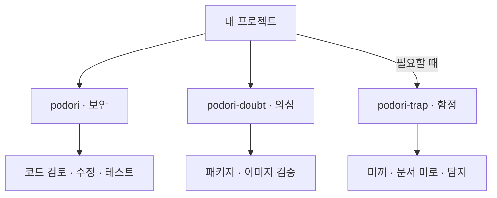

# podori


한국어 | [English](README.en.md)

**AI 코딩 에이전트를 위한 앱·웹 보안 스킬.**

기능이 잘 동작해도 권한 검사 하나가 빠지면 다른 사람의 데이터가 보일 수 있습니다. 늘 쓰던 컨테이너 이미지에 낯선 시작 스크립트가 들어 있을 수도 있습니다.

podori(포돌이)는 코딩 에이전트가 이런 빈틈을 살펴보도록 만든 세 가지 스킬입니다. 코드의 취약점을 고치고, 안전해 보이는 의존성도 의심합니다. 필요하다면 미끼와 함정으로 무단 탐색에 맞섭니다.

| 주제 | 스킬 | 하는 일 |
|---|---|---|
| 보안 | [podori](skills/podori/SKILL.md) | 취약점을 찾아 고치고, 테스트로 확인합니다. |
| 의심 | [podori-doubt](skills/podori-doubt/SKILL.md) | 안전해 보이는 패키지와 이미지도 출처와 내용을 검증합니다. |
| 함정 | [podori-trap](skills/podori-trap/SKILL.md) | 미끼와 함정을 설치해 무단 탐색을 탐지합니다. |

기본은 코드 보안입니다. 의존성 검증과 함정은 필요에 따라 골라 씁니다. 세 스킬은 각각 독립적으로 사용할 수 있으며, 서로를 자동으로 실행하지 않습니다.

## 시작하기

원하는 `skills/<스킬 이름>/` 폴더를 에이전트의 스킬 경로에 통째로 복사합니다. `SKILL.md`와 함께 참조 문서, 템플릿도 들어 있습니다.

프로젝트에서 스킬 이름만 호출하면 됩니다. 별도의 요청문은 필요하지 않습니다. 무엇을 점검하고 어떤 함정을 만들지는 에이전트가 프로젝트의 코드와 설정을 읽고 판단합니다.

프로젝트 정보만으로 대상을 정할 수 없거나 추가 승인이 필요할 때만 확인을 요청합니다. 설치 위치와 호출 방식은 에이전트마다 다르며, 아래는 슬래시 호출을 지원하는 경우의 예시입니다.

### podori · 보안

관리자 버튼을 숨겼어도 API를 누구나 호출할 수 있다면, 화면만 가린 셈입니다.

`podori`는 공격자 관점에서 코드를 살펴봅니다. 권한 검사, 입력값 처리, 파일 업로드를 점검하고, 여러 허점을 엮는 공격도 검토합니다. 확인한 문제는 고치고, 기존 기능이 깨지지 않았는지도 테스트합니다.

```text
/podori
```

검토만 요청하면 코드는 바꾸지 않습니다. 함정도 임의로 추가하지 않습니다.

### podori-doubt · 의심

출처가 익숙하다고 내용까지 믿지는 않습니다. 취약점 스캔을 통과했더라도 시작 스크립트에 수상한 코드가 들어 있다면 따로 살펴봐야 합니다.

`podori-doubt`는 패키지의 설치 스크립트와 이미지의 시작 명령, 레이어를 검토합니다. 승인된 원본과 달라진 부분을 확인하고, 서명과 빌드 기록도 검증합니다. 허용된 범위 안에서 레지스트리와 클러스터를 조회해 해당 패키지나 이미지가 어디에서 쓰이는지도 추적합니다.

```text
/podori-doubt
```

검사하려고 의심 패키지를 설치하거나 이미지를 실행하지 않습니다. 확인한 사실과 의심, 확인하지 못한 부분을 구분합니다.

### podori-trap · 함정

가짜 키를 따라 들어간 API에도, 그 안에서 찾은 문서에도 실제 비밀은 없습니다.

`podori-trap`은 프로젝트에 맞는 미끼 키와 API, 문서 미로를 만드는 스킬입니다. 무단 탐색을 미끼로 유도하고, 실제 접근 여부를 서버에서 확인해 기록합니다. 함정은 운영자가 관리하는 서비스 안에만 둡니다.

```text
/podori-trap
```

숨겨진 미끼 이벤트도 만들 수 있지만, 단순한 페이지 조회나 DOM 열람을 공격으로 판정하지 않습니다. 미끼에는 실제 데이터나 권한을 연결하지 않습니다.

새 함정은 꺼진 상태로 만듭니다. 운영 환경에서 함정을 켜기 전에는 자원 사용 한도와 종료 조건을 정하고 별도 승인을 받습니다.

## 필요한 곳에 골라 쓰기

아래는 실행 순서가 아니라 각 스킬이 맡는 일입니다.



## 알아둘 점

podori는 에이전트가 읽고 따르는 지침입니다. 설치만으로 방어 기능이 켜지지는 않으며, 실제 기능은 대상 프로젝트에서 구현하고 테스트해야 합니다.

결과에는 확인한 근거와 실제 테스트 결과를 남깁니다. 확인하지 못한 항목을 안전하다고 처리하지 않습니다. 레지스트리·클러스터 조회는 허용한 범위에서만 진행하며, 운영 환경 변경은 별도 승인이 필요합니다.

세 스킬 모두 영어 지침과 참조 문서, 템플릿을 포함합니다. 버전은 `0.1.0`입니다.

[변경 이력](CHANGELOG.md) · [MIT](LICENSE) · VerifiedIdiot
