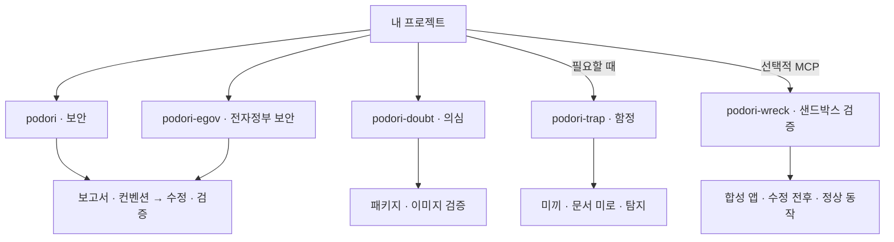

# podori

**AI 코딩 에이전트를 위한 앱·웹 보안 스킬.**

한국어 안내 | [English](README.en.md) · `0.5.0`

podori(포돌이)는 코드의 취약점을 찾아 고치고 안전해 보이는 패키지와 이미지도 의심합니다. 요청하면 미끼와 함정을 만들어 무단 탐색의 흔적을 남깁니다.

## 만든 배경

최근 소속 팀에서 수십 개 저장소에 흩어진 Node.js, Python, Java, nginx 등의 취약점을 패치했습니다. 이 과정에서 정리한 점검 항목과 수정·검증 절차를 다른 개발자들도 활용할 수 있도록 공유하고자 합니다.

## 필요한 스킬 고르기

앱·웹 코드를 살펴보려면 `podori`부터 시작합니다. eGovFrame 프로젝트에는 `podori-egov`를 씁니다.

| 이럴 때 | 사용할 스킬 |
|---|---|
| 앱·웹 코드의 보안 문제를 찾아 고치고 싶을 때 | [podori · 보안](skills/podori/SKILL.md) |
| eGovFrame 버전에 맞춰 보안을 점검할 때 | [podori-egov · 전자정부 보안](skills/podori-egov/SKILL.md) |
| 패키지나 이미지의 출처와 내용이 의심될 때 | [podori-doubt · 의심](skills/podori-doubt/SKILL.md) |
| 미끼와 함정으로 무단 탐색을 탐지하고 싶을 때 | [podori-trap · 함정](skills/podori-trap/SKILL.md) |
| 동봉한 합성 앱에서 수정 전후의 동작을 비교할 때 | [podori-wreck · 샌드박스 검증](skills/podori-wreck/SKILL.md) |

각 스킬은 독립적으로 씁니다. 다른 스킬을 자동으로 실행하지 않습니다.

<details>
<summary>스킬별 역할 한눈에 보기</summary>

아래 그림은 실행 순서가 아니라 각 스킬이 맡는 일입니다.



</details>

## 시작하기

1. 원하는 `skills/<스킬 이름>/` 폴더를 에이전트의 스킬 경로에 통째로 복사합니다. 기본 보안 점검은 `skills/podori/`를 선택합니다.
2. 대상 프로젝트에서 스킬을 호출합니다. 아래는 슬래시 호출을 지원하는 에이전트의 예시입니다.

```text
/podori
```

에이전트가 프로젝트의 코드와 설정을 읽고 점검 대상을 정합니다. 추가 요청문은 필요하지 않습니다. 대상을 정할 근거가 부족하거나 별도 승인이 필요할 때만 확인을 요청합니다. 검토만 요청하면 코드를 바꾸지 않습니다.

설치 위치와 호출 방식은 에이전트마다 다릅니다. 각 폴더에 지침과 참조 자료가 함께 들어 있어 출처 링크를 열지 않아도 절차를 따를 수 있습니다.

보안·전자정부·의심·함정 스킬은 MCP 없이 쓸 수 있습니다. `podori-wreck`만 별도의 로컬 MCP와 호스트가 발급한 실행 승인이 필요합니다. 설정 방법은 [MCP 안내](mcp/README.md)에 있습니다.

## 스킬 둘러보기

### podori · 보안

관리자 버튼을 숨겨도 API까지 잠기지는 않습니다.

`podori`는 공격자 관점에서 코드와 설정을 살펴봅니다. 권한 검사, 입력값 처리, 파일 업로드를 점검하고 여러 허점을 엮는 공격도 검토합니다. 보안 보고서와 기존 코드 컨벤션을 정리한 뒤 확인한 문제를 허용된 범위에서 고칩니다. 수정 후에는 보안과 정상 기능, 컨벤션 준수 여부를 함께 검증합니다.

```text
/podori
```

검토만 요청하면 코드를 바꾸지 않습니다. 함정도 임의로 추가하지 않습니다.

### podori-egov · 전자정부 보안

eGovFrame 프로젝트는 버전부터 맞춰 봅니다. 실행환경, 공통컴포넌트, 실제 의존성 버전을 구분하고 3.x·4.x·5.x에 맞는 보안 규칙과 코드 사례를 적용합니다.

보고서 작성부터 수정과 검증까지 기본 절차는 `podori`와 같습니다.

```text
/podori-egov
```

확인한 버전 밖의 안전성이나 지원 여부를 추정하지 않습니다. 코드 사례의 테스트는 실제 프로젝트 검증을 대신하지 않습니다.

### podori-doubt · 의심

익숙한 패키지라고 설치 스크립트까지 믿지는 않습니다.

패키지의 설치 스크립트, 이미지의 시작 명령과 레이어를 살펴봅니다. 승인된 원본과 비교하고 서명과 빌드 기록도 검증합니다. 허용된 범위에서는 레지스트리와 클러스터를 읽기 전용으로 조회해 어디에 쓰이는지도 추적합니다.

```text
/podori-doubt
```

검사하려고 의심 패키지를 설치하거나 이미지를 실행하지 않습니다. 대상을 수정하지 않고 확인한 사실과 의심·미확인 항목을 나눠 보고합니다.

### podori-trap · 함정

미끼 키와 가짜 API, 문서 미로로 무단 탐색을 유도하고 접근 흔적을 남깁니다. 실제 접근 여부는 서버에서 확인합니다.

```text
/podori-trap
```

함정은 운영자가 관리하는 서비스 안에만 만듭니다. 미끼에는 실제 데이터나 권한을 연결하지 않습니다. 숨겨진 미끼 이벤트도 만들 수 있지만 평범한 페이지 조회나 DOM 열람을 공격으로 판정하지 않습니다.

새 함정은 꺼진 상태로 만듭니다. 운영 환경에서 켜려면 자원 사용 한도와 종료 조건을 정하고 별도 승인을 받아야 합니다.

### podori-wreck · 샌드박스 검증

동봉한 합성 HTTP 앱에서 수정 전후를 직접 비교합니다. 같은 초기 데이터에서 취약본과 수정본에 같은 요청을 보내고 권한 검사와 입력 검증 결과를 확인합니다. 정상 요청이 그대로 동작하는지도 함께 봅니다.

```text
/podori-wreck
```

현재 대상은 동봉한 합성 앱뿐입니다. 로컬 stdio MCP가 보고서 항목에 연결된 호스트 승인을 확인한 뒤 실행합니다. 모델은 승인을 발급하지 않습니다.

외부 통신 차단과 격리, 자원·시간 제한을 확인하지 못하면 실행하지 않습니다. 실제 요청·응답과 상태 변화를 증거로 남기고 끝나면 해당 실험의 자원만 정리합니다. 실행하지 못한 항목은 미검증으로 남깁니다.

임의 저장소·이미지·경로·셸 명령이나 운영·외부 대상은 받지 않습니다. 자율 탐색, 공격 연쇄, 코드 실행 취약점 실증, 파괴·자원 고갈 시험도 지원하지 않습니다. 악성 코드를 실행하는 범용 샌드박스가 아닙니다. 자세한 실행 조건은 [MCP 안내](mcp/README.md)를 참고합니다.

## 결과 확인과 작업 종료

각 스킬은 보고서에서 이번 작업의 대상과 완료 기준, 필요한 검증을 먼저 정합니다. 필수 항목을 처리하고 검증을 통과하면 결과를 반환합니다. 보안 수정은 관련 회귀 검증까지 확인하고 마칩니다.

새로 발견한 별개 문제와 선택적인 개선은 후속 목록에 남깁니다. 필요한 승인이나 검증 근거를 확보하지 못하면 미완료 항목과 이유를 남기고 중단합니다. `podori-doubt`는 수정 없이 읽기 전용 평가 결과를 반환합니다.

## 알아둘 점

스킬은 에이전트가 읽고 따르는 지침입니다. 설치만으로 프로젝트의 방어 기능이 켜지지는 않습니다. `podori-wreck`의 MCP도 운영 환경의 안전성을 대신 검증하지 않습니다.

확인하지 못한 항목을 안전하다고 처리하지 않습니다. 레지스트리·클러스터 조회는 허용한 범위에서만 진행하며 운영 환경 변경은 별도 승인이 필요합니다. 에이전트용 지침·규칙·참조·템플릿은 영어로 제공합니다. 사용자용 README는 한국어·영어 한 쌍으로 제공합니다.

[변경 이력](CHANGELOG.md) · [MIT](LICENSE) · VerifiedIdiot
