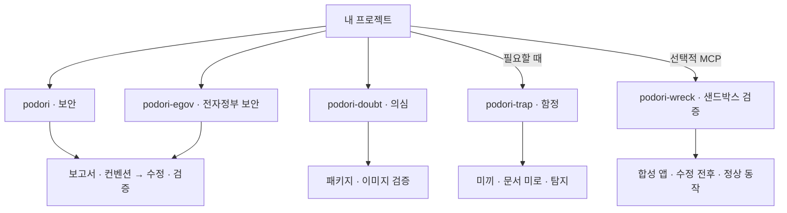

# podori · AI 코딩 에이전트용 보안 코드 리뷰 스킬

**취약점은 고치고, 정상 동작은 다시 확인합니다.**

한국어 안내 | [English](README.en.md) · `0.8.0`

podori(포돌이)는 AI 코딩 에이전트를 위한 보안 스킬 모음입니다. 앱·웹의 보안 코드 리뷰부터 취약점 수정과 회귀 테스트까지 안내합니다.

전자정부프레임워크(eGovFrame)의 시큐어코딩, 패키지·컨테이너 이미지의 공급망 보안, 요청에 따른 미끼·함정 구현을 각각 독립 스킬로 제공합니다. 샌드박스 검증은 동봉한 합성 앱의 수정 전후만 비교합니다.

**gVisor로 호스트 커널의 공격면을 줄입니다.** 선택형 `runsc`는 앱의 시스템 콜을 사용자 공간 커널에서 처리해 호스트 커널 취약점의 직접 악용 경로를 줄입니다.

## 만든 배경

최근 소속 팀에서 수십 개 저장소에 흩어진 Node.js, Python, Java, nginx 등의 취약점을 패치했습니다. 이 과정에서 정리한 점검 항목과 수정·검증 절차를 다른 개발자들도 활용할 수 있도록 공유하고자 합니다.

## 필요한 스킬 고르기

앱·웹의 보안 코드 리뷰는 `podori`부터 시작합니다. eGovFrame(전자정부프레임워크) 프로젝트에는 `podori-egov`를 씁니다.

| 이럴 때 | 사용할 스킬 |
|---|---|
| 앱·웹의 취약점을 찾아 고치고 회귀 테스트까지 확인할 때 | [podori · 보안](skills/podori/SKILL.md) |
| 정부 보안약점 기준과 전자정부프레임워크 버전별 시큐어코딩을 점검할 때 | [podori-egov · 전자정부 보안](skills/podori-egov/SKILL.md) |
| 패키지·컨테이너 이미지의 출처와 공급망 보안을 점검할 때 | [podori-doubt · 의심](skills/podori-doubt/SKILL.md) |
| 미끼와 함정으로 무단 탐색을 탐지하고 싶을 때 | [podori-trap · 함정](skills/podori-trap/SKILL.md) |
| 동봉한 합성 앱에서 수정 전후의 동작을 비교할 때 | [podori-wreck · 샌드박스 검증](skills/podori-wreck/SKILL.md) |

각 스킬은 독립적으로 씁니다. 다른 스킬을 자동으로 실행하지 않습니다.

**폐쇄망 대응은 다섯 스킬의 공통 조건입니다.** 에이전트·모델·도구·근거를 미리 준비하고, 연결망과 폐쇄망에서 같은 기준과 절차를 따릅니다. 도구·모델·의존성을 자동으로 설치하거나 교체하지 않습니다.

보안·전자정부 보안·의심 스킬은 취약점 심각도를 CVSS v4.0 기준으로 구분합니다. 점수 근거가 부족하면 미평가로 남깁니다. 등급은 실행 승인이나 필수 검증을 대신하지 않습니다.

## 필요한 만큼 읽고, 정한 기준까지 검증합니다

구현·점검·수정 단계에 필요한 지침만 읽도록 안내합니다. 일반 기능 개발을 전체 보안 감사로 확대하지 않습니다. 확인된 문제를 모아 수정하고, 보안 조건과 정상 동작을 함께 다시 검증합니다. 필수 검증이 끝나면 종료하며, 작업 전체의 수정·재검토는 최대 두 차례로 제한합니다. 한도에 닿아도 필수 결함이 남으면 미완료로 반환합니다.

최신 취약점 확인이 필요하면 승인된 네트워크와 준비된 도구로 공식 API·제품 공급자 공지를 먼저 조회합니다. 대상 버전과 관련된 근거를 검토·수정 단계 시작 전에 고정하고, 수정할 때마다 검색을 다시 시작하지 않습니다. 폐쇄망에서는 반입된 근거를 사용하며, 오래된 자료나 조회 실패를 안전 판정으로 바꾸지 않습니다.

문서의 조건부 로딩과 작업 한도는 에이전트가 따르는 지침입니다. 별도 컨텍스트 격리나 실행환경의 강제 제한을 설치하지 않으며, 특정 에이전트나 추가 MCP 서버를 필수로 요구하지 않습니다.

<details>
<summary>스킬별 역할 한눈에 보기</summary>

아래 그림은 실행 순서가 아니라 각 스킬이 맡는 일입니다.



</details>

## 시작하기

1. 원하는 `skills/<스킬 이름>/` 폴더를 에이전트의 스킬 경로에 통째로 복사합니다. 기본 보안 점검은 `skills/podori/`를 선택합니다.
2. 대상 프로젝트에서 스킬을 호출합니다. 아래는 슬래시 호출을 지원하는 에이전트의 예시입니다.

```text
/podori
```

에이전트가 프로젝트의 코드와 설정을 읽고 점검 대상을 정합니다. 추가 요청문은 필요하지 않습니다. 대상을 정할 근거가 부족하거나 별도 승인이 필요할 때만 확인을 요청합니다. 검토만 요청하면 코드를 바꾸지 않습니다.

설치 위치와 호출 방식은 에이전트마다 다릅니다. 검토에 필요한 지침과 참조 자료는 각 스킬 폴더에 함께 들어 있습니다.

갱신할 때는 릴리스 태그 `v0.8.0`을 기준으로 기존 설치본을 백업한 뒤 선택한 폴더 전체를 교체합니다. `SKILL.md`의 버전뿐 아니라 전체 파일 구성이 해당 태그와 일치하는지 확인합니다. 사용하지 않는 스킬은 설치하지 않아도 됩니다.

## 스킬 둘러보기

### podori · 보안

관리자 버튼을 숨겨도 API까지 잠기지는 않습니다.

`podori`는 공격자 관점에서 코드와 설정을 살펴봅니다. 권한 검사, 입력값 처리, 파일 업로드를 점검하고 여러 허점을 엮는 공격도 검토합니다. 보안 보고서와 기존 코드 컨벤션을 정리한 뒤 확인한 문제를 허용된 범위에서 고칩니다. 수정 후에는 보안과 정상 기능, 컨벤션 준수 여부를 함께 검증합니다.

```text
/podori
```

검토만 요청하면 코드를 바꾸지 않습니다. 함정도 임의로 추가하지 않습니다.

### podori-egov · 전자정부 보안

`podori-egov`는 전자정부프레임워크 프로젝트의 시큐어코딩을 점검하고 확인한 문제의 수정과 회귀 검증을 안내합니다. 실행환경·공통컴포넌트·실제 의존성 버전을 구분해 3.x·4.x·5.x의 해당 규칙과 코드 사례를 적용합니다.

행정안전부고시 제2025-1호 별표 3의 설계 20개·구현 49개 항목을 동봉했습니다. 각 항목의 적용 조건과 점검·검증 방법을 제공합니다. 근거와 결과는 [항목별 점검표](skills/podori-egov/templates/criteria-coverage.md)에 남깁니다. [출처와 기준 판본](skills/podori-egov/references/government-baseline.md)에서 원문과 적용 범위를 확인할 수 있습니다.

정부 기준의 출처와 준비 사항, 미확인 항목의 처리는 [전자정부 보안 사용 안내](skills/podori-egov/README.md)에 있습니다.

```text
/podori-egov
```

[3.x CSRF 설정](skills/podori-egov/references/versions/3.x/cases/csrf/README.md), [4.x CSRF 설정](skills/podori-egov/references/versions/4.x/cases/csrf/README.md), [5.x 소유권 검사](skills/podori-egov/references/versions/5.x/cases/ownership/README.md) 사례에서 실행 명령과 기대 결과를 확인할 수 있습니다.

확인한 버전 밖의 안전성이나 지원 여부를 추정하지 않습니다. 코드 사례의 테스트는 실제 프로젝트 검증을 대신하지 않습니다.

### podori-doubt · 의심

익숙한 패키지라고 설치 스크립트까지 믿지는 않습니다.

패키지·컨테이너 이미지의 공급망 보안을 읽기 전용으로 점검합니다. 설치 스크립트, 시작 명령과 이미지 레이어를 살펴보고 승인된 원본과 비교합니다. 서명과 빌드 기록도 검증합니다. 허용된 범위에서는 레지스트리와 클러스터를 조회해 어디에 쓰이는지도 추적합니다.

```text
/podori-doubt
```

검사하려고 의심 패키지를 설치하거나 이미지를 실행하지 않습니다. 대상을 수정하지 않고 확인한 사실과 의심·미확인 항목을 나눠 보고합니다.

### podori-trap · 함정

미끼 키와 가짜 API, 문서 미로로 무단 탐색을 유도하고 접근 흔적을 남깁니다. 실제 접근 여부는 서버에서 확인합니다.

```text
/podori-trap
```

함정은 운영자가 관리하는 서비스 안에만 만듭니다. 미끼에는 실제 데이터나 권한을 연결하지 않습니다. 숨겨진 미끼 이벤트도 만들 수 있지만 평범한 페이지 조회나 DOM 열람을 공격으로 판정하지 않습니다.

새 함정은 꺼진 상태로 만듭니다. 운영 환경에서 켜려면 자원 사용 한도와 종료 조건을 정하고 별도 승인을 받아야 합니다.

### podori-wreck · 샌드박스 검증

**Docker에 gVisor(`runsc`)를 선택해 실행합니다.** Linux ARM64·AMD64 환경에 맞는 이미지를 사용하며, 선택한 런타임을 확인하지 못하면 실행을 거절합니다.

동봉한 합성 HTTP 앱에서 수정 전후를 직접 비교합니다. 같은 초기 데이터에서 취약본과 수정본에 같은 요청을 보내고 권한 검사와 입력 검증 결과를 확인합니다. 정상 요청이 그대로 동작하는지도 함께 봅니다.

```text
/podori-wreck
```

현재 대상은 동봉한 합성 앱뿐입니다. 로컬 stdio MCP가 보고서 항목에 연결된 호스트 승인을 확인한 뒤 실행합니다. 모델은 승인을 발급하지 않습니다.

외부 통신 차단과 격리, 자원·시간 제한을 확인하지 못하면 실행하지 않습니다. 실제 요청·응답과 상태 변화를 증거로 남기고 끝나면 해당 실험의 자원만 정리합니다. 실행하지 못한 항목은 미검증으로 남깁니다.

임의 저장소·이미지·경로·셸 명령이나 운영·외부 대상은 받지 않습니다. 자율 탐색, 공격 연쇄, 코드 실행 취약점 실증, 파괴·자원 고갈 시험도 지원하지 않습니다. 악성 코드를 실행하는 범용 샌드박스가 아닙니다. gVisor도 호스트 보안 패치를 대신하거나 모든 취약점의 차단을 보장하지 않습니다. 자세한 실행 조건은 [MCP 안내](mcp/README.md)를 참고합니다.

## 결과 확인과 작업 종료

각 스킬은 이번 작업의 대상과 완료 기준, 필요한 검증을 먼저 고정합니다. 보안 수정은 확인한 결함만 대상으로 하며, 보안 조건과 기존 정상 동작을 함께 검증합니다. 필수 항목을 모두 검증하면 추가 개선 탐색 없이 결과를 반환합니다.

기본 작업 예산은 30분이며, 같은 필수 항목의 시도는 최초 시도를 포함해 최대 2회입니다. 사용자는 다른 유한한 예산을 지정할 수 있습니다. 더 엄격한 호스트·실행 승인 제한이 있으면 그 제한을 따릅니다. 보고서 갱신이나 에이전트 위임으로 예산을 초기화하지 않습니다.

바뀌지 않은 입력의 유효한 검증 근거는 재사용합니다. 근거가 달라진 항목과 영향받는 경계만 다시 확인합니다. 같은 실패에 새로운 근거가 없거나 수정이 이전 실패 상태로 되돌아가면 중단합니다. 한도에 도달하면 새 조사·수정·검증을 멈추고, 허용된 자원 정리와 보고만 마칩니다. 미완료 필수 항목은 `BLOCKED`로 남깁니다.

별개 결함과 선택적인 개선은 후속 목록으로 분리합니다. `podori-doubt`는 소스와 연결된 의존성·빌드·설치·실행 경로를 읽기 전용으로 평가하며, 같은 레지스트리에 있다는 이유만으로 대상을 늘리지 않습니다.

이 예산은 에이전트가 따르는 지침입니다. 강제 시간·토큰 차단은 호스트의 제어 기능이 필요합니다. 토큰 사용량을 계측할 수 없으면 미측정으로 남기며 절감량을 추정하지 않습니다.

## 자주 묻는 질문

### `SKILL.md`만 복사하면 되나요?

선택한 스킬 폴더 전체를 복사해야 합니다. `SKILL.md`는 작업 절차를 안내합니다. `references/`와 `templates/`는 상세 규칙과 보고서 양식을 담습니다. 출처 링크를 열지 않아도 동봉한 지침으로 검토할 수 있습니다. 에이전트용 지침은 영어로 제공합니다. 사용자용 README는 한국어·영어 한 쌍으로 제공합니다.

### MCP가 필요한가요?

`podori`, `podori-egov`, `podori-doubt`, `podori-trap`은 MCP 없이 쓸 수 있습니다. `podori-wreck`만 별도의 로컬 MCP와 호스트가 발급한 실행 승인이 필요합니다. 설정 방법은 [MCP 안내](mcp/README.md)에 있습니다.

### 폐쇄망에서도 사용할 수 있나요?

전체 스킬과 선택형 MCP의 공통 기준입니다. 폐쇄망·외부망에서 같은 판본·입력·준비된 도구로 같은 절차를 따릅니다. 망 연결 여부에 따라 검사 기준이나 필수 통제를 바꾸지 않습니다.

에이전트·모델·도구·의존성은 각 환경에 미리 준비해야 합니다. MCP에는 승인된 이미지와 선택한 런타임도 필요합니다. 검토·실행 중 자동 다운로드나 기준 갱신을 하지 않으며, 자료 수집과 갱신은 별도 승인 작업으로 분리합니다. 필요한 근거가 없으면 미검증으로 남깁니다.

### 정부 기준 점검이 공식 보안 인증을 대신하나요?

`podori-egov`는 동봉한 판본의 기준으로 개발 보안 점검을 돕습니다. 공식 인증이나 법적 준수 판정을 대신하지 않습니다. 버전별 코드 사례와 `podori-wreck`의 합성 앱 테스트도 실제 프로젝트의 보안성을 보증하지 않습니다.

## 알아둘 점

스킬은 에이전트가 읽고 따르는 지침입니다. 설치만으로 프로젝트의 방어 기능이 켜지지는 않습니다. `podori-wreck`의 MCP도 운영 환경의 안전성을 대신 검증하지 않습니다.

확인하지 못한 항목을 안전하다고 처리하지 않습니다. 레지스트리·클러스터 조회는 허용한 범위에서만 진행하며 운영 환경 변경은 별도 승인이 필요합니다.

[변경 이력](CHANGELOG.md) · [MIT](LICENSE) · VerifiedIdiot
