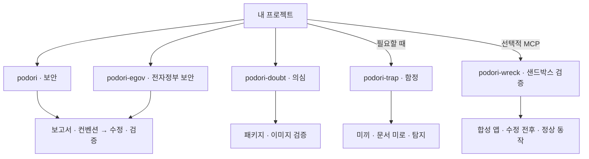

# podori

**AI 코딩 에이전트를 위한 앱·웹 보안 스킬.**

한국어 안내 | [English](README.en.md)

현재 버전은 `0.5.0`입니다.

기능이 잘 동작해도 권한 검사 하나가 빠지면 다른 사람의 데이터가 보일 수 있습니다. 늘 쓰던 컨테이너 이미지에 낯선 시작 스크립트가 들어 있을 수도 있습니다.

podori(포돌이)는 코딩 에이전트가 이런 빈틈을 살펴보도록 만든 독립 스킬 모음입니다. 코드의 취약점을 고치고 안전해 보이는 의존성도 의심합니다. 필요하다면 미끼와 함정으로 무단 탐색에 맞섭니다.

## 시작하기

원하는 `skills/<스킬 이름>/` 폴더를 에이전트의 스킬 경로에 통째로 복사합니다. 필요한 지침과 참조 자료가 함께 들어 있어 출처 링크를 열지 않아도 절차를 따를 수 있습니다.

기존 보안·전자정부·의심·함정 스킬은 프로젝트에서 이름만 호출하면 됩니다. 별도의 요청문 없이 에이전트가 코드와 설정을 읽고 대상을 정합니다. `podori-wreck`는 별도 MCP와 보고서에 연결된 실행 승인이 필요하며 현재는 동봉한 합성 앱만 지원합니다.

프로젝트 정보만으로 대상을 정할 수 없거나 추가 승인이 필요할 때만 확인을 요청합니다. 설치 위치와 호출 방식은 에이전트마다 다르며 아래는 슬래시 호출을 지원하는 경우의 예시입니다.

## 스킬 고르기

기본은 코드 보안입니다. eGovFrame 프로젝트에는 `podori-egov`를 선택합니다. 각 스킬은 서로를 자동으로 실행하지 않습니다. 샌드박스 검증을 쓰지 않으면 MCP를 설치할 필요가 없습니다.

| 주제 | 스킬 | 하는 일 |
|---|---|---|
| 보안 | [podori](skills/podori/SKILL.md) | 보안 보고서를 바탕으로 수정하고 테스트로 확인합니다. |
| 전자정부 보안 | [podori-egov](skills/podori-egov/SKILL.md) | 같은 보안 절차를 eGovFrame 버전별 규칙과 코드에 적용합니다. |
| 의심 | [podori-doubt](skills/podori-doubt/SKILL.md) | 안전해 보이는 패키지와 이미지도 출처와 내용을 검증합니다. |
| 함정 | [podori-trap](skills/podori-trap/SKILL.md) | 미끼와 함정을 설치해 무단 탐색을 탐지합니다. |
| 샌드박스 검증 | [podori-wreck](skills/podori-wreck/SKILL.md) | 승인한 합성 앱에서 보고서 항목의 수정 전후와 정상 동작을 비교합니다. |

## 보고서 기준 작업 종료

수정 전에 보고서의 대상 항목·완료 기준·필수 검증을 고정합니다. 필수 항목을 해결하고 관련 회귀 검증을 통과하면 결과를 반환합니다.

새로 발견한 별개 문제와 선택적인 개선은 후속 목록으로 분리합니다. 필요한 승인이나 검증 근거를 확보할 수 없으면 미완료 항목과 이유를 남기고 중단합니다.

`podori-doubt`는 읽기 전용 평가 결과만 반환하며 의심 대상을 실행하거나 수정하지 않습니다.

### podori · 보안

관리자 버튼을 숨겼어도 API를 누구나 호출할 수 있다면 화면만 가린 셈입니다.

`podori`는 공격자 관점에서 코드를 살펴봅니다. 권한 검사, 입력값 처리, 파일 업로드를 점검하고 여러 허점을 엮는 공격도 검토합니다. 보안 보고서와 기존 코드 컨벤션을 먼저 정리한 뒤 확인한 문제를 허용된 범위에서 수정합니다. 수정 후에는 보안뿐 아니라 정상 동작과 컨벤션 준수 여부도 검증합니다.

```text
/podori
```

검토만 요청하면 코드는 바꾸지 않습니다. 함정도 임의로 추가하지 않습니다.

### podori-egov · 전자정부 보안

`podori`와 같은 보고서·컨벤션 정리, 수정, 검증 절차를 eGovFrame에 적용합니다. 공통 보안 기준과 3.x·4.x·5.x별 규칙·코드 사례를 함께 제공합니다.

```text
/podori-egov
```

실행환경과 공통컴포넌트, 실제 의존성 버전을 구분해 적용 범위를 판단합니다. 확인한 버전을 넘어 안전성이나 지원 여부를 추정하지 않습니다. 코드 사례의 테스트는 실제 프로젝트 검증을 대신하지 않습니다.

### podori-doubt · 의심

출처가 익숙하다고 내용까지 믿지는 않습니다. 취약점 스캔을 통과했더라도 시작 스크립트에 수상한 코드가 들어 있다면 따로 살펴봐야 합니다.

`podori-doubt`는 패키지의 설치 스크립트와 이미지의 시작 명령, 레이어를 검토합니다. 승인된 원본과 달라진 부분을 확인하고 서명과 빌드 기록도 검증합니다. 허용된 범위 안에서 레지스트리와 클러스터를 조회해 해당 패키지나 이미지가 어디에서 쓰이는지도 추적합니다.

```text
/podori-doubt
```

확인한 사실과 의심, 확인하지 못한 부분을 구분합니다. 검사하려고 의심 패키지를 설치하거나 이미지를 실행하지 않습니다.

### podori-trap · 함정

가짜 키를 따라 들어간 API에도 그 안에서 찾은 문서에도 실제 비밀은 없습니다.

`podori-trap`은 프로젝트에 맞는 미끼 키와 API, 문서 미로를 만드는 스킬입니다. 무단 탐색을 미끼로 유도하고 실제 접근 여부를 서버에서 확인해 기록합니다. 함정은 운영자가 관리하는 서비스 안에만 둡니다.

```text
/podori-trap
```

미끼에는 실제 데이터나 권한을 연결하지 않습니다. 숨겨진 미끼 이벤트도 만들 수 있지만 단순한 페이지 조회나 DOM 열람을 공격으로 판정하지 않습니다.

새 함정은 꺼진 상태로 만듭니다. 운영 환경에서 함정을 켜기 전에는 자원 사용 한도와 종료 조건을 정하고 별도 승인을 받습니다.

### podori-wreck · 샌드박스 검증

보고서의 주장과 실제 동작이 같은지 확인합니다. 선택적 로컬 stdio MCP가 동봉한 작은 HTTP 앱의 권한 검사와 입력 검증 사례를 실행합니다. 동일한 초기 데이터에서 취약본과 수정본에 같은 요청을 보내고 정상 요청도 함께 확인합니다.

```text
/podori-wreck
```

현재 대상은 동봉한 합성 앱뿐입니다. 임의 저장소·이미지·경로·셸 명령은 받지 않습니다. 실행 승인은 모델이 발급하지 않고 호스트 측에서 별도로 준비합니다. 실행 방법과 승인 절차는 [MCP 안내](mcp/README.md)를 참고합니다.

외부 통신 차단, 호스트·다른 실험과의 격리, 자원·시간 제한을 실행 조건으로 검사합니다. 필요한 조건을 확인하지 못하면 실행하지 않습니다. 운영·외부 대상 시험, 자율 탐색·연쇄 확대, 코드 실행 취약점 실증, 파괴·자원 고갈 시험은 지원하지 않습니다.

실제 요청·응답과 상태 변화를 증거로 남기며 실행하지 못한 항목은 미검증으로 구분합니다. 실험이 끝나면 해당 실험의 자원만 정리합니다. 이 기능은 임의의 악성 코드를 안전하게 실행하는 범용 샌드박스가 아닙니다.

## 필요한 곳에 골라 쓰기

아래는 실행 순서가 아니라 각 스킬이 맡는 일입니다.



## 알아둘 점

스킬은 에이전트가 읽고 따르는 지침입니다. 설치만으로 대상 프로젝트의 방어 기능이 켜지지는 않습니다. `podori-wreck`의 MCP는 별도로 실행하는 개발 도구이며 운영 환경을 대신 검증하지 않습니다.

결과에는 확인한 근거와 실제 테스트 결과를 남깁니다. 확인하지 못한 항목을 안전하다고 처리하지 않습니다. 레지스트리·클러스터 조회는 허용한 범위에서만 진행하며 운영 환경 변경은 별도 승인이 필요합니다.

스킬 지침과 참조 문서는 영어로 제공합니다.

[변경 이력](CHANGELOG.md) · [MIT](LICENSE) · VerifiedIdiot
